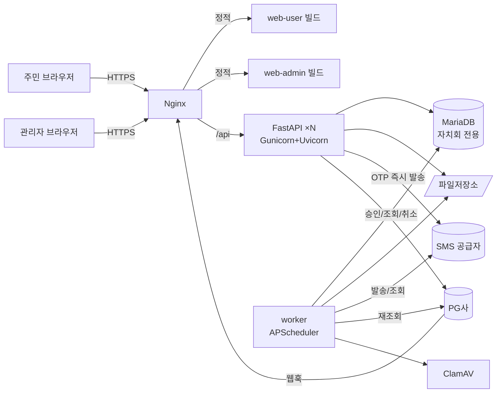
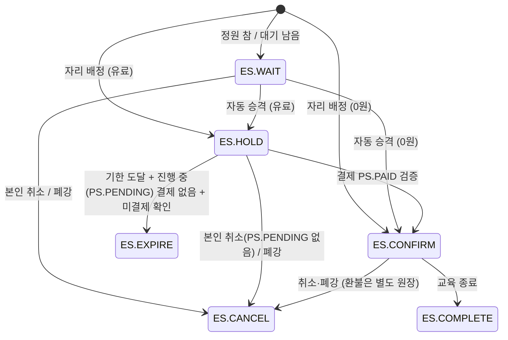
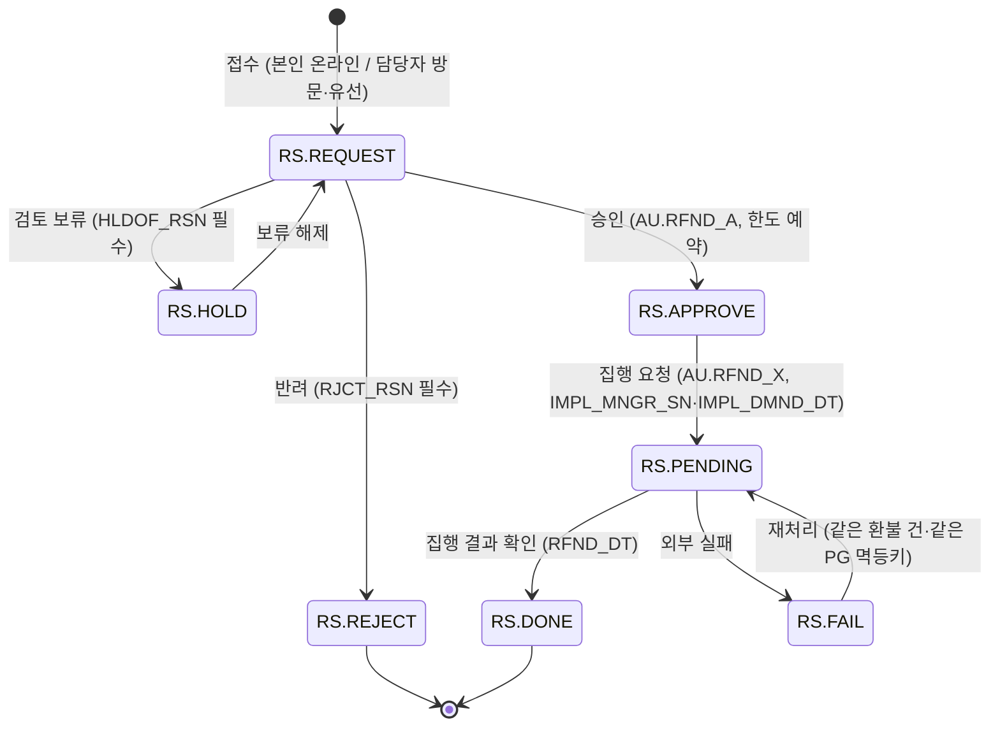
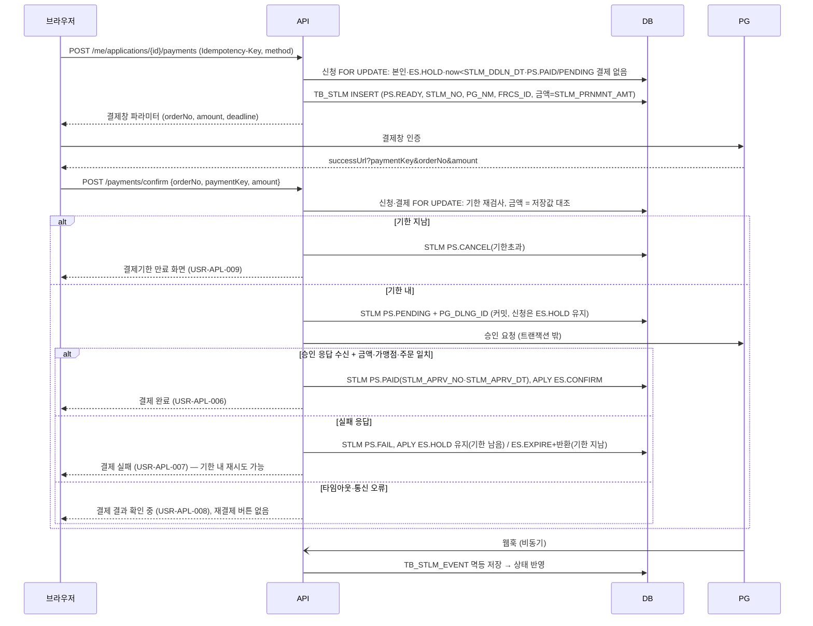

# TDD —주민자치센터 플랫폼 구축 기술 설계서

| 항목 | 내용 |
|---|---|
| 문서 | 기술 설계서 (Technical Design Document) |
| 버전 | 0.2 · 2026-10-31 (DB 스키마 설계안 v0.5 반영) |
| 독자 | 내부 개발팀 |
| 선행 문서 | [PRD.md](PRD.md) · [TRD.md](TRD.md) · [ADR.md](ADR.md) |
| 데이터 모델 | [PRJ_2026_002_DB스키마_설계안.md](PRJ_2026_002_DB스키마_설계안.md) v0.5 (이하 "스키마") |
| 화면 | [화면설계서.md](화면설계서.md) |

> **데이터 모델 기준**: 테이블·컬럼·타입·키·FK·공통코드·무결성규칙은 스키마(45테이블·610컬럼·184FK·코드 40집합·규칙 135개)를 따른다([ADR-027](ADR.md#adr-027)). 이 문서는 컬럼을 다시 적지 않고 `스키마 4.N`처럼 절 번호와 규칙 ID(R11, SEAT-01 등)로 참조한다. 0.1판의 `[보완]` 테이블(TB_CORS_PLAN, TB_WRKR_HRTBT)은 철회했다.

---

## 1. 설계 원칙

1. **서버가 유일한 판정자다.** 정원·기한·금액·권한·공개 여부는 API에서만 판정한다. 프런트엔드 표시는 서버 응답을 그대로 그린다.
2. **원장은 덮어쓰지 않는다.** 신청·결제·환불·감면 판정·동의·감사이력은 상태 전이와 새 행으로만 기록한다.
3. **같은 요청은 같은 결과를 낸다.** 상태 변경 API는 멱등키를 받는다([ADR-014](ADR.md#adr-014)).
4. **외부 호출은 트랜잭션 밖에서 한다.** 잠금 구간 안에서 PG·SMS를 호출하지 않는다.
5. **모르면 모른다고 표시한다.** 결과 불명은 `확인 중`, 자료 없음은 빈 상태로 둔다. 미확인 값을 추정해 채우지 않는다(스키마 1.2).
6. **코드가 있다고 기능을 켜지 않는다.** `AU.MBR_W`, `PM.VIRTUAL`, `AP.ADMIN` 등은 현재 수행방안상 비활성이다(스키마 5.1, 6절).

---

## 2. 시스템 아키텍처

### 2.1 배포 구성 (자치회 1곳당, [ADR-002](ADR.md#adr-002))


### 2.2 저장소 구조 ([ADR-021](ADR.md#adr-021))
```
/apps
  /api
    /app
      main.py                 # FastAPI 앱, 라우터 등록
      /core                   # 설정, DB 세션, 보안, 시각(UTC↔Asia/Seoul), 예외, 멱등, 일련번호 직렬화
      /auth                   # 세션·로그인·OTP·권한 판정
      /domain
        /member  /course  /cycle  /facility  /instructor
        /application  /payment  /refund  /reduction
        /board  /content  /terms  /code  /sms
        /attendance  /stats  /export  /audit  /file
      /adapters
        /pg   (base.py, mock.py, toss.py ...)
        /sms  (base.py, mock.py, ...)
        /scan (clamav.py)
      /routers
        /user                 # /api/v1/...
        /admin                # /api/admin/v1/...
        /webhook              # /api/pg/webhook/{provider}
    /migrations               # Alembic (스키마 N09: 버전순 마이그레이션 한 벌)
    /tests
  /worker
    jobs.py                   # 스케줄 정의, api 도메인 서비스 재사용
  /web-user                   # React (기본 + 쉬운 화면)
  /web-admin                  # React
/packages
  /ui                         # 토큰·컴포넌트
  /api-client                 # OpenAPI → TS
```

### 2.3 백엔드 계층 (스키마 C03)
| 계층 | 책임 | 금지 |
|---|---|---|
| router | 요청 파싱, 인증 의존성, 응답 직렬화 | 업무 판정 |
| service | 트랜잭션 경계, 업무 규칙, 권한 판정 호출, 감사이력 기록 | HTTP 객체 참조 |
| repository | 쿼리, 잠금(`with_for_update`), 운영묶음 조건 강제 | 업무 규칙 |
| adapter | 외부 시스템 호출 | DB 접근 |

- API 필드명은 DB 약어를 노출하지 않는다(`courseName`, `paymentAmount`, 스키마 C02).
- 일련번호(`NUMERIC(22,0)`)는 JSON 문자열로 주고받는다. 프런트엔드는 JS `Number`로 바꾸지 않는다(스키마 C05).

---

## 3. 모듈 설계와 요구사항 매핑

| 모듈 | 책임 | RQ (FN) | 주요 테이블 | 단위시험 |
|---|---|---|---|---|
| auth | 로그인·로그아웃·세션·잠금·OTP | 024, 029, 061, 062 | TB_LGN_SSN, TB_LGN_FAIL_HSTRY, TB_CERT_DMND | UT-006, UT-007 |
| member | 가입·정보수정·탈퇴·동의·거주지 확인 | 029~032, 065 | TB_MBR, TB_MBR_AGRE_HSTRY, TB_DONG | UT-006, UT-007 |
| authz | 관리자 역할·범위·위임 | 056, NF-SER-003/004/009 | TB_MNGR, TB_MNGR_ROLE, TB_MNGR_SCP, TB_ROLE_AUTHRT | UT-018 |
| cycle | 교육기수 | 047 | TB_EDU_CYCL | UT-014 |
| course | 강좌·분류·공개·폐강·조회 | 004, 005, 012~015, 048, 057, 058 | TB_CORS, TB_CORS_CLSF | UT-004, UT-014, UT-015 |
| schedule | 정규 일정·휴보강·시설 중복 | 049 | TB_CORS_SCHDL, TB_CORS_SCHDL_CHG | UT-015 |
| facility | 센터·강의실 | 022, 050 | TB_FCLT | UT-015 |
| instructor | 공개 강사·모집·지원·심사 | 018, 019, 027, 051 | TB_INSTR, TB_INSTR_RCRT, TB_INSTR_APLY | UT-005, UT-013 |
| application | 신청·대기·승격·취소·만료 | 014, 023, 025, 033~037 | TB_ATNLC_APLY | UT-008, UT-009 |
| reduction | 사전 감면 심사·적용 판정 | 038, 039 | TB_RDCT_BFHD_SRNG, TB_RDCT_HSTRY, TB_RDCT_HSTRY_FILE | UT-011 |
| payment | 결제요청·승인검증·웹훅·확인중·영수증 | 026, 040~042, 063 | TB_STLM, TB_STLM_EVENT | UT-010, UT-024 |
| refund | 환불 신청·승인·집행·재처리·한도 | 017, 043~046 | TB_RFND | UT-012 |
| board | 게시판·게시물·후기·문의·FAQ | 006, 020, 021, 052, 053 | TB_BBS, TB_PST | UT-005, UT-016 |
| content | 홈·센터·배너·팝업 | 006, 011, 054, 071, 072 | TB_SITE_CONTS, TB_OPER_BNDL, TB_FCLT | UT-002, UT-017 |
| terms | 약관·동의문 버전 | 030, 055 | TB_SITE_CONTS, TB_MBR_AGRE_HSTRY | UT-007, UT-017 |
| code | 공통 코드 표시명 | 058 | TB_COM_CD | UT-017 |
| sms | 자동 알림·관리자 발송·OTP 발송 | 028, 029, 059 | TB_SMS_DMND, TB_SMS_DMND_CORS, TB_SMS_TRGT, TB_SMS_SNDNG_HSTRY | UT-019 |
| attendance | 출석 입력·조회 | 064 | TB_CORS_ATND, TB_CORS_ATND_DTL, TB_CORS_ATND_HSTRY | UT-022 |
| stats | 대시보드·통계 | 060, 066, 067 | TB_MBR_STATS_SRC/TOT, TB_CORS_DGSTFN_SRC/QITEM/TOT | UT-020, UT-023 |
| export | CSV·암호화 내보내기 | 068 | TB_JOB_HSTRY | UT-025 |
| audit | 감사이력 기록·조회 | NF-SER-005 | TB_JOB_HSTRY | 공통 |
| file | 업로드·검사·다운로드 | 021, NF-SER-002 | TB_FILE | 공통 |
| setting | 운영 기준·검토 상태 조회 | 069 | TB_SITE_CONTS(`CT.OPER_RULE`), TB_JOB_HSTRY | — |

---

## 4. 인증·인가 설계

### 4.1 주체
| 주체 | 테이블 | 세션 유휴 | 쿠키 |
|---|---|---|---|
| 회원 | TB_MBR | 30분 | `u_sid` (user 도메인) |
| 관리자 | TB_MNGR | 15분 | `a_sid` (admin 도메인) |
| 강사 | TB_MBR(`MT.INSTR`) + TB_INSTR(`IS.APPROVE`) | 회원 세션 | 강사 기능은 `INSTR_STTS_CD='IS.APPROVE'`일 때만 (R03, R04) |
| 시스템(워커) | — | — | 감사이력 `ACTR_TYPE_CD='AK.SYSTEM'` |

### 4.2 관리자 권한 모델 (스키마 4.17~4.21, 6절)
```
TB_MNGR ─1:N─ TB_MNGR_SCP (배정 행: ROLE_SN + SCP_TYPE_CD + OPER_BNDL_SN/DONG_SN + 유효기간 + 부여자)
                  └─N:1─ TB_MNGR_ROLE (전역 역할 정의)
                              └─1:N─ TB_ROLE_AUTHRT (ROLE_SN × AUTHRT_CD)
```
- 역할·범위·유효기간을 **한 배정 행**에 함께 둔다. 다른 행의 역할과 동 범위를 곱집합으로 합치지 않는다(R20).
- 범위 유형(R19)
  | SCP_TYPE_CD | OPER_BNDL_SN | DONG_SN | 의미 |
  |---|---|---|---|
  | `SK.SYSTEM` | NULL | NULL | 운영구조·역할배정 작업만. 회원·결제·콘텐츠 본문 권한 없음(R29) |
  | `SK.GROUP` | 필수 | NULL | 운영묶음 전체 |
  | `SK.DONG` | 필수 | 필수 | 특정 동 |

**역할 템플릿 (스키마 6절, 실제 계정에 자동 부여하지 않음)**
| ROLE_ID | 역할명 | 허용 범위 | 비고 |
|---|---|---|---|
| SYSTEM_CONFIG | 전체 운영구조 관리자 | SK.SYSTEM | 묶음·동·관리자 계정·역할·배정 |
| GROUP_MANAGER | 운영묶음 관리자 | SK.GROUP | 계정 자체 변경·역할 정의·묶음 재편 불가 |
| DONG_MANAGER | 동 담당자 | SK.DONG | 묶음 공통 문안·공통강사 승인·게시판 정의·교육기수 변경 불가 |
| COURSE_STAFF | 강좌 담당자 | SK.GROUP / SK.DONG | 강좌·신청 |
| CONTENT_STAFF | 콘텐츠 담당자 | SK.GROUP / SK.DONG | 게시물·콘텐츠. 약관·동의문은 묶음 범위만 |
| FINANCE_STAFF | 결제·환불 담당자 | SK.GROUP / SK.DONG | 승인(AU.RFND_A)·집행(AU.RFND_X)을 한 사람에게 줄지는 기관 결정(PRD Q22) |

**업무별 기능권한 (AU 코드집합)**
| 업무 | 권한 코드 | 근거 |
|---|---|---|
| 강좌 조회 / 등록·공개·폐강 | AU.CORS_R / AU.CORS_W | 스키마 6절 |
| 강좌분류 관리 | AU.CORS_W (제안) | 스키마에 별도 코드 없음, PRD Q21 |
| 교육기수 관리 | AU.CONF_W (제안) | DONG_MANAGER 기수 변경 불가와 일치, PRD Q21 |
| 시설 | AU.FCLT_W | 6절 |
| 강사 심사·승인 | AU.INSTR_W | R04 |
| 신청 조회 / 처리 | AU.APLY_R / AU.APLY_W | 6절 |
| 감면 사전심사 | 확인 필요 (후보 AU.APLY_W) | 스키마 6.1 "심사관리자 권한"만 기재, PRD Q21 |
| 결제 조회 / 대사·수동 확인 | AU.STLM_R / AU.STLM_W | 6절 |
| 환불 승인 / 집행 | AU.RFND_A / AU.RFND_X | 6절 |
| 게시판 정의 | AU.BBS_W | 6절 |
| 게시물·문의 답변 | AU.POST_W | 6절 |
| 홈 콘텐츠·약관·운영기준 콘텐츠 | AU.SITE_W | 6절, OPER-RVW-01 |
| 회원 조회 | AU.MBR_R (`AU.MBR_W`는 비활성) | FN-065, 스키마 1.3 |
| 문자 발송 | AU.SMS_SEND | 6절 |
| 대시보드·통계 | AU.STAT_R | 6절 |
| 출석 조회 | AU.ATND_R | FN-064 |
| 작업이력 조회 | AU.LOG_R | 6.1 |
| 개인정보 내보내기 | AU.EXPORT | [ADR-026](ADR.md#adr-026) |
| 권한 배정 / 역할 정의 / 관리자 계정 | AU.GRANT_W / AU.ROLE_W / AU.MNGR_W | 6절 |
| 묶음·동 구조 | AU.GRP_R / AU.GRP_W / AU.DONG_W | 6절 |
| 공통코드 표시명·보존 파기 검토·운영기준 조회 | 확인 필요 | PRD Q21 |

### 4.3 판정 함수
```python
def authorize(mngr_sn, authrt_cd, bndl_sn, dong_sn=None) -> None:
    """같은 배정 행(MNGR_SCP_SN)에서 기능·범위·유효기간을 동시에 만족해야 통과 (R20, RQ-SER-NF-003)"""
    ok = db.scalar("""
      SELECT 1 FROM TB_MNGR m
        JOIN TB_MNGR_SCP s     ON s.MNGR_SN = m.MNGR_SN
        JOIN TB_MNGR_ROLE r    ON r.ROLE_SN = s.ROLE_SN AND r.USE_YN = 'Y'
        JOIN TB_ROLE_AUTHRT ra ON ra.ROLE_SN = s.ROLE_SN AND ra.AUTHRT_CD = :authrt
       WHERE m.MNGR_SN = :mngr AND m.USE_YN = 'Y' AND s.USE_YN = 'Y'
         AND s.VLD_BGNG_DT <= UTC_TIMESTAMP(6)
         AND (s.VLD_END_DT IS NULL OR UTC_TIMESTAMP(6) < s.VLD_END_DT)
         AND s.SCP_TYPE_CD IN ('SK.GROUP','SK.DONG')
         AND s.OPER_BNDL_SN = :bndl
         AND (s.SCP_TYPE_CD = 'SK.GROUP' OR (:dong IS NOT NULL AND s.DONG_SN = :dong))
       LIMIT 1""", ...)
    if not ok: raise Forbidden
```
- `bndl_sn`, `dong_sn`은 **대상 레코드에서 읽은 값**을 넣는다. 요청 파라미터 값을 넣지 않는다(R26, RQ-SER-NF-009).
- 신청·결제·환불·결제이력의 동은 `TB_ATNLC_APLY → TB_CORS.DONG_SN`(강좌 운영 동)이다. 회원의 동이 아니다(스키마 6.1).
- 동 미지정 자료(`DONG_SN IS NULL`)는 `SK.GROUP` 배정만 접근한다. 동 권한은 NULL 데이터 수정권한을 포함하지 않는다. `DONG_SN` 미지정 회원도 동 담당자에게 공개하지 않는다(스키마 6.1).
- `SK.SYSTEM` 배정은 위 함수로 통과하지 않는다. 구조 관리 API는 별도 `authorize_system(mngr_sn, authrt_cd)`로 `SK.SYSTEM` 배정과 허용목록 권한(AU.GRP_*, AU.DONG_W, AU.MNGR_W, AU.ROLE_W, AU.GRANT_W)만 검사한다(R29).
- 목록 API는 같은 조건을 `WHERE` 절로 내려 범위 밖 행을 아예 조회하지 않는다.

### 4.4 권한 위임 (RQ-SER-NF-004, R28)
- `AU.GRANT_W` 보유자만 배정한다. `GRNT_MNGR_SN`에 부여자를 남긴다.
- 배정하려는 역할의 모든 권한·범위·기간이 부여자 자신의 유효 배정 안에 있어야 한다. 스키마에 위임가능 여부 컬럼이 없으므로 "보유 권한 이하"로 판정한다.
- 자기 자신(`MNGR_SN = GRNT_MNGR_SN`)에게는 배정하지 않는다. 자기 권한 상승은 다른 부여자만 할 수 있다(R28).
- 동 담당자는 묶음 공통 강사승인·교육기수·게시판정의·동의문 권한을 배정받거나 배정할 수 없다(R28).
- 배정·회수는 TB_JOB_HSTRY에 전후 값과 함께 남기고, 회수 시 대상 관리자의 세션을 재검사한다(AUTH-05).

### 4.5 회원 본인 판정 (RQ-SER-NF-001)
- 회원 API는 경로에 회원 ID를 받지 않는다. `/api/v1/me/...` 형태로 세션의 `MBR_SN`만 쓴다.
- 신청·결제·환불·문의 등 개별 리소스 조회는 `WHERE ... AND MBR_SN = :session_mbr` 조건을 붙이고, 없으면 404를 반환한다(존재 여부 노출 방지).
- 운영묶음은 사이트(`TB_OPER_BNDL.SITE_ID`)와 세션에서 서버가 정한다. 클라이언트가 보낸 묶음 ID를 쓰지 않는다(R26).

---

## 5. 수강신청·결제 핵심 설계

### 5.1 상태 머신

#### 신청 (TB_ATNLC_APLY.APLY_STTS_CD, 코드집합 ES)

| 코드 | 화면 표시 | 정원 점유 | 대기 점유 |
|---|---|---|---|
| ES.WAIT | 대기 N번 (WAIT 행 중 순위) | ✕ | ○ |
| ES.HOLD | 결제대기 (남은 시간) | ○ | ✕ |
| ES.HOLD + 결제 PS.PENDING | 결제 결과 확인 중 | ○ | ✕ |
| ES.CONFIRM | 수강확정 | ○ | ✕ |
| ES.CANCEL | 신청취소 (사유가 폐강이면 "폐강") | ✕ | ✕ |
| ES.EXPIRE | 결제기한 만료 | ✕ | ✕ |
| ES.COMPLETE | 수강종료 | ✕ | ✕ |

- "결제 결과 확인 중"은 별도 신청 상태가 아니다. `ES.HOLD`이면서 같은 신청에 `PS.PENDING` 결제가 있는 경우다. 이때 재결제·만료·취소·재배정을 모두 막는다([ADR-006](ADR.md#adr-006), SEAT-02).
- 폐강은 ES 코드가 없으므로 `ES.CANCEL` + `RTRCN_RSN`(폐강)으로 남기고, 화면은 강좌 `CS.CANCEL`과 함께 "폐강"으로 표시한다.
- `WTNG_SEQ`는 `ES.WAIT`일 때만 값이 있다. 승격 시 비운다(R10). 승격 전 순번은 TB_JOB_HSTRY에 남는다.

#### 결제 (TB_STLM.STLM_STTS_CD, 코드집합 PS)
`PS.READY(결제창 파라미터 발급) → PS.PENDING(승인 요청 직전 커밋, 결과 대기·불명) → PS.PAID | PS.FAIL`, `PS.READY → PS.CANCEL(승인 전 취소: 기한 초과·본인 취소)`, `PS.READY → PS.FAIL`.
- `PS.PAID`는 이후 환불이 있어도 바뀌지 않는다. 부분·전액 환불은 TB_RFND에만 남는다(R13, R14).
- `PM.CARD`, `PM.TRANSFER`만 쓴다. `PM.VIRTUAL`·`PM.MANUAL`은 코드만 있고 비활성이다.

#### 환불 (TB_RFND.RFND_STTS_CD, 코드집합 RS)

주민 화면 단계 표시: REQUEST=접수, APPROVE·PENDING·FAIL=처리 중, HOLD=보류(사유), DONE=완료, REJECT=반려(사유). **환불완료는 RS.DONE에서만** 표시한다(FN-044).

### 5.2 신청 생성 알고리즘 (FN-014, 025, 033, 034, 038, 039)
```python
def create_application(mbr_sn, cors_sn, idem_key, body):
    # 0) 멱등 (R31): 같은 (OPER_BNDL_SN, IDEM_KEY) 행이 있으면 회원·강좌가 같을 때만 기존 결과
    prev = repo.find_by_idem(bndl, idem_key)
    if prev: return prev if (prev.MBR_SN, prev.CORS_SN) == (mbr_sn, cors_sn) else raise Conflict  # 409

    with session.begin():
        cors = repo.lock_course(bndl, cors_sn)                 # 잠금 순서 강좌→회원→신청 (C07)
        now  = db_utc_now()
        # 1) 접수 가능: 공개(CS.OPEN) + RCPT_BGNG_DT ≤ now < RCPT_END_DT (목록·상세와 같은 is_open_for_apply)
        if not is_open_for_apply(cors, now): raise Rejected("접수기간이 아닙니다")
        mbr = repo.lock_member(bndl, mbr_sn)                   # 감면 1강좌 확보용 (RDCT-BFHD-02)
        ensure_member_active(mbr)                              # MS.ACTIVE
        # 2) 거주 우선 (RCPT-PRIOR-01, G04)
        resident = mbr.HAB_IDNTY_STTS_CD == 'RV.OK' and mbr.HAB_RGN_CD in ('RA.JORI', 'RA.PAJU_ETC')
        if not resident:
            if cors.OTSD_RGN_RCPT_BGNG_DT is None or now < cors.OTSD_RGN_RCPT_BGNG_DT:
                raise Rejected("파주시 주민 우선접수 기간입니다")
        # 3) 중복: UQ_FILTER_ATNLC_APLY_01이 최종 방어. 사전 조회로 친절한 메시지
        if repo.has_active(bndl, mbr_sn, cors_sn): raise Rejected("이미 신청한 강좌입니다")
        # 4) 금액 (서버 산정, R09)
        srng = reduction.find_usable_approval(mbr, cors.EDU_CYCL_SN, now)   # 아래 5.5
        amt  = calc_amount(cors.TTCHG, srng)
        # 5) 배정 (ADR-028: 카운터 없이 행 집계)
        occupied = repo.count(cors_sn, ('ES.HOLD', 'ES.CONFIRM'))
        waiting  = repo.count(cors_sn, ('ES.WAIT',))
        if waiting == 0 and occupied < cors.RCRT_NOPE:
            app = new_app(APLY_STTS_CD='ES.CONFIRM' if amt.pay == 0 else 'ES.HOLD',
                          SEAT_ALTMNT_DT=now,
                          STLM_DDLN_DT=None if amt.pay == 0 else now + timedelta(seconds=600))  # SEAT-01
        elif waiting < cors.WTNG_NOPE and resident_or_waitlist_allowed(resident):   # PRD Q5
            app = new_app(APLY_STTS_CD='ES.WAIT', WTNG_SEQ=repo.max_wait_seq(cors_sn) + 1)
        else:
            raise Rejected("정원과 대기정원이 모두 찼습니다")
        app.TTCHG_AMT, app.RDCT_AMT, app.STLM_PRNMNT_AMT = amt.fee, amt.rdct, amt.pay
        if srng:
            app.RDCT_RSN, app.RDCT_MNGR_SN = srng.reason, srng.SRNG_MNGR_SN    # R09: 감면 > 0이면 필수
        app.IDEM_KEY = idem_key
        repo.insert(app)
        if srng:
            reduction.record_applied(app, srng)    # TB_RDCT_HSTRY(DR.APPROVE) INSERT
        audit.log('APLY_CREATE', app)
    return app
```
- `is_open_for_apply`는 목록·상세·쉬운 화면의 상태 배지 계산과 **같은 함수**를 쓴다(FN-014, RQ-QUR-NF-008).
- 0원 확정은 TB_STLM 행을 만들지 않는다(R12).
- 접수 순서는 `(APLY_DT, ATNLC_APLY_SN)`이다. 스키마에 별도 접수순번 컬럼은 없다.
- 재신청은 **새 행**이다. 이전 행은 바꾸지 않는다(스키마 4.10).
- 관외 신청자가 관외 개방 이후 잔여 정원이 없을 때 대기 접수까지 허용할지는 원천이 "잔여 정원 확인 후 허용"으로만 적었다. 기본값은 대기 불가이며 PRD Q5로 확인한다.

### 5.3 자리 반환과 자동 승격 (FN-035, 036, 037)
```python
def release_seat(cors, app, to_status, reason):        # 반드시 cors 잠금 보유 상태에서 호출
    app.APLY_STTS_CD = to_status                        # ES.CANCEL / ES.EXPIRE
    app.RTRCN_DT, app.RTRCN_RSN = db_utc_now(), reason if to_status == 'ES.CANCEL' else (None, None)
    promote_waiters(cors)                               # SEAT_ALTMNT_DT는 지우지 않는다 (SEAT-02)

def promote_waiters(cors):
    now = db_utc_now()
    if not promotion_allowed(cors, now):   # 폐강·종료 등. 접수 종료 후 승격 여부는 PRD Q16
        return
    while repo.count(cors.sn, ('ES.HOLD','ES.CONFIRM')) < cors.RCRT_NOPE:
        nxt = repo.next_waiter(cors.sn)    # WHERE ES.WAIT ORDER BY WTNG_SEQ, ATNLC_APLY_SN LIMIT 1 FOR UPDATE
        if nxt is None: break
        if not member_still_eligible(nxt): # 탈퇴·잠금 → ES.CANCEL(사유: 자격 상실) 후 다음
            ...; continue
        nxt.APLY_STTS_CD = 'ES.CONFIRM' if nxt.STLM_PRNMNT_AMT == 0 else 'ES.HOLD'
        nxt.SEAT_ALTMNT_DT = now
        nxt.STLM_DDLN_DT = None if nxt.STLM_PRNMNT_AMT == 0 else now + timedelta(seconds=600)
        nxt.WTNG_SEQ = None                                                   # R10
        sms.enqueue_auto(src_event_id=f"PROMO:{nxt.sn}:{now.isoformat()}",   # 아웃박스, UQ로 중복 방지
                         mbr_sn=nxt.MBR_SN, template='PROMO',
                         vars={cors_nm, seat_dt, ddln_dt, link})
        audit.log('APLY_PROMOTE', nxt, actor='AK.SYSTEM')
```
- SMS는 같은 트랜잭션에서 TB_SMS_DMND(`SM.AUTO`, `SG.EVENT`) + TB_SMS_TRGT에 **아웃박스 행으로만** 쌓고, 실제 발송은 커밋 후 워커가 한다. 중복은 `UQ(OPER_BNDL_SN, DMND_TYPE_CD, SRC_EVENT_ID)`가 막는다. 발송 실패·지연은 기한에 영향이 없다(FN-028).
- 여러 자리가 동시에 반환돼도 강좌 행 잠금 하나로 직렬화되므로 이중 승격이 없다.

### 5.4 결제 흐름 (FN-040, 041, 042, RQ-QUR-NF-006)
2단계 승인(결제창 인증 → 서버 승인) 방식 PG를 기준으로 설계한다. 1단계 방식 PG가 선정되면 5.4.3의 지연 승인 처리 비중이 커진다.


모든 응답·통보·재조회는 TB_STLM_EVENT에 `ET.RESPONSE`/`ET.WEBHOOK`/`ET.RECON`으로 남긴다. `EVENT_CN`에는 정규화된 허용 항목만 넣고 PG 전문을 복사하지 않는다.

#### 5.4.1 성공 반영 규칙
- `UQ_FILTER_STLM_01`(`STLM_STTS_CD='PS.PAID'`일 때 `(OPER_BNDL_SN, ATNLC_APLY_SN)` 유일)로 신청당 성공 1건을 DB가 보장한다. MariaDB 구현(생성 컬럼 + UNIQUE 등)은 물리 DDL에서 정한다(N10).
- 같은 PG 거래의 중복 연결은 `UQ_STLM_04(PG_NM, FRCS_ID, PG_DLNG_ID)`가 막는다.
- 브라우저가 넘긴 `amount`는 대조용으로만 쓰고 저장값과 다르면 승인 요청 자체를 하지 않는다(R13).

#### 5.4.2 웹훅 멱등 (FN-041, R23, R30)
```
수신 → 서명 검증 실패: 401, 보안로그만 (DB 미저장)
     → 주문번호·PG 거래 ID로 TB_STLM 식별 실패: 보안로그 격리 (R23)
     → (OPER_BNDL_SN, STLM_SN, EVENT_ID) 존재?
         - 같은 EVENT_HASH_VL: 기존 처리 결과 반환(200), 업무 갱신 없음
         - 다른 EVENT_HASH_VL: 충돌 보안사건. 업무 반영 안 함, TB_JOB_HSTRY(JR.DENY)·보안로그 기록, 대사 화면 노출
     → 신규: EP.RECEIVED로 저장 → PG 조회 API로 실제 상태 재확인 → 같은 트랜잭션에서 상태 반영 + EP.DONE
```
- 처리 중 장애는 `EP.PROCESS`/`EP.FAIL` + `RTRY_NMTM`으로 재시도한다.

#### 5.4.3 결과 확인 중 처리 ([ADR-006](ADR.md#adr-006))
- 워커 `pg_recheck`(30초 주기): `PS.PENDING` 결제를 원주문번호로 재조회. 1분 간격 최대 3회. 재조회 횟수는 해당 결제의 `ET.RECON` 이벤트 수로 센다.
- 3회 후에도 미확정 → `PS.PENDING` 유지, 대시보드 "승인 결과 확인" 업무 생성. 운영자가 익영업일까지 ADM-PAY-003P에서 수동 대사(AU.STLM_W).
- 기한 후 PAID로 확인됐는데 자리가 이미 반환됐다면(정상 흐름상 PENDING은 자리를 지키므로 발생하지 않아야 함) 무조건 확정하지 않고 대사·보상환불 경로로 올린다(R12).

#### 5.4.4 결제기한 만료 (FN-036)
- 워커 `expire_payments`(10초 주기)는 아래 쿼리로 대상을 집는다.
  ```sql
  SELECT a.OPER_BNDL_SN, a.ATNLC_APLY_SN, a.CORS_SN FROM TB_ATNLC_APLY a
   WHERE a.APLY_STTS_CD = 'ES.HOLD' AND a.STLM_DDLN_DT <= UTC_TIMESTAMP(6)
     AND NOT EXISTS (SELECT 1 FROM TB_STLM s
                      WHERE s.OPER_BNDL_SN = a.OPER_BNDL_SN AND s.ATNLC_APLY_SN = a.ATNLC_APLY_SN
                        AND s.STLM_STTS_CD = 'PS.PENDING')
   ORDER BY a.STLM_DDLN_DT LIMIT 100 FOR UPDATE SKIP LOCKED
  ```
  건마다 강좌 잠금 → 해당 신청에 `PS.READY` 결제가 남아 있으면 PG 조회로 미결제 확인 후 `PS.CANCEL` → 신청 `ES.EXPIRE` + `release_seat`.
- 결제 요청·승인 API가 기한을 직접 검사하므로 워커 지연(최대 10초)은 정원 반환 지연일 뿐 기한 연장이 아니다.

### 5.5 금액 산정과 감면 (FN-038, 039)
```
TTCHG_AMT        = TB_CORS.TTCHG (관리자 등록값 스냅샷)
RDCT_AMT         = floor(TTCHG_AMT × 50 / 100)    # 사용 가능한 사전심사 승인이 있을 때만, 아니면 0
STLM_PRNMNT_AMT  = TTCHG_AMT − RDCT_AMT           # ≥ 0 (R09)
```
- 세 값 모두 신청 행에 스냅샷으로 저장한다. 강좌 수강료가 나중에 바뀌어도 기존 신청 금액은 바뀌지 않는다(기존 신청 금액 변경 정책은 운영 확인 후, FN-048).
- 요청 본문의 금액 필드는 스키마에 없다(무시가 아니라 수신 자체를 하지 않음).
- 검수 예시: 100,000원 → 감면 50,000원 → 결제예정 50,000원.

**사용 가능한 감면 승인** (`find_usable_approval`, RDCT-BFHD-01·02)
1. 회원이 조리읍 거주로 확인됨: `HAB_RGN_CD='RA.JORI'` + `HAB_IDNTY_STTS_CD='RV.OK'`.
2. TB_RDCT_BFHD_SRNG에 같은 회원·같은 기수(`EDU_CYCL_SN`)의 `DS.APPROVED` 행이 있고 `VLD_END_DT`가 비었거나 지나지 않음. 대상 유형은 `DR.LIVELIHD`·`DR.VETERAN`·`DR.DISABLED` 3종만.
3. 회원 행 잠금 아래에서 같은 기수의 다른 신청에 `DR.APPROVE` 감면 이력이 없음. 이전 감면 신청이 취소·만료·환불됐어도 **자동 복구하지 않는다**. 담당자가 명시적으로 해제(해당 신청에 `DR.REJECT` 이력 + 사유 추가, 제안)한 경우에만 다시 쓸 수 있다.
- 적용 결과는 TB_RDCT_HSTRY(`ATNLC_APLY_SN`, `DR.APPROVE`, `RDCT_AMT`, `RDCT_BFHD_SRNG_SN`, `DCSN_MNGR_SN`=사전심사 승인자)에 INSERT만 한다. 증빙은 사전심사 소유 파일(TB_FILE.RDCT_BFHD_SRNG_SN)이며 판정별 연결은 TB_RDCT_HSTRY_FILE에 남긴다.
- 사전심사 승인 후 내용·증빙은 덮어쓰지 않는다. 재심사는 새 심사건이다(RDCT-BFHD-01).

### 5.6 환불 산정과 한도 (FN-017, 043, 045)
**반환 기준액 (잠정, 기관 승인본 우선)**
```
if 오늘 < EDU_BGNG_YMD:   기준액 = 결제액
else:
    월수강료   = floor(결제액 / 교육기간_개월수)      # 교육기간_개월수 = 시작월~종료월 포함 개수
    경과개월   = (오늘 연월 − 시작 연월) + 1           # 당월 포함
    기준액     = max(0, 결제액 − 월수강료 × 경과개월)
```
> "개강 후 당월분 제외"의 월 단위 환산은 원천에 공식이 없다. 위 공식은 제안이며 PRD Q15로 확인한다. 스키마에 기준액 컬럼이 없으므로 산정 근거(기준일·개월수·기준액)는 승인 시 TB_JOB_HSTRY `CHG_CN`에 남긴다.

**한도 검사 (원결제 단위 직렬화, R14)**
```python
with session.begin():
    stlm = repo.lock_payment(bndl, stlm_sn)                 # 잠금 순서 결제→환불 (C07)
    reserved = sum(r.RFND_AMT for r in stlm.refunds
                   if r.RFND_STTS_CD in ('RS.DONE', 'RS.APPROVE', 'RS.PENDING'))
    if reserved + req_amt > stlm.STLM_AMT: raise Rejected("환불 가능 금액을 초과합니다")
    ...  # 접수(RS.REQUEST 생성) 때 사전 검사, 승인(RS.APPROVE 전이) 때 확정 검사
```
- 검수 예시: 원결제 100,000원에 60,000원 2건 동시 승인 → 두 번째 승인은 잠금 대기 후 한도 초과로 거절.
- `RS.FAIL → RS.PENDING` 재처리 때도 같은 검사를 다시 한다.
- 원결제액(`STLM_AMT`)은 절대 갱신하지 않는다. 화면의 "남은 환불 가능액"은 계산값이다.
- 요청자는 `DMND_MBR_SN`(본인 온라인) 또는 `DMND_MNGR_SN`(방문·유선 대리 접수) 중 정확히 하나다(R15). 방문/유선 구분 컬럼은 없다(PRD Q29).

**집행·재처리 (FN-046)**
- PG 취소 요청의 멱등키는 환불 건 고유값 `RFND-{OPER_BNDL_SN}-{RFND_SN}`으로 고정한다. 재처리도 같은 키를 쓰므로 PG 측에서 이중 취소가 되지 않는다(R14).
- 외부 응답 유실 시 PG 거래 조회로 실제 취소 여부를 확인한 뒤에만 `RS.DONE`/`RS.FAIL`로 바꾼다. 결과는 TB_STLM_EVENT(`RFND_SN` 연결)에 남는다.
- 수동 계좌환불은 은행코드·계좌암호문·예금주암호문이 함께 있을 때만 활성화한다(R15). 담당자가 이체 후 "집행 결과 확인"을 입력해야 `RS.DONE`이 된다.

### 5.7 취소와 재신청 (FN-037)
| 현재 상태 | 본인 취소 | 결과 |
|---|---|---|
| ES.WAIT | 가능 | ES.CANCEL, 대기 반환 |
| ES.HOLD (PENDING 결제 없음) | 가능 | ES.CANCEL, READY 결제는 PS.CANCEL, 정원 반환 → 승격 |
| ES.HOLD + PS.PENDING | 불가 | "결제 결과 확인 후 이용" 안내 |
| ES.CONFIRM (결제 있음) | 환불 신청으로 유도 | 환불 원장 생성. 신청은 환불 접수 시 ES.CANCEL로 전환하고 정원 반환 (개강 후 반환 여부는 PRD Q18) |
| ES.CONFIRM (0원) | 가능 (개강 전) | ES.CANCEL, 정원 반환 |

재신청은 **새 행**이다. 새 자리배정일시·새 기한을 받는다. 이전 행은 바꾸지 않는다.

---

## 6. 데이터 모델

### 6.1 기준과 공통 규칙
상세 정의는 스키마 4절(테이블 상세), 5절(공통코드·무결성규칙), 7절(도메인·명명·구현 공통규칙)이다. 구현 시 아래를 지킨다.

| 항목 | 규칙 | 스키마 근거 |
|---|---|---|
| 엔진·문자셋 | InnoDB, `utf8mb4` / `utf8mb4_unicode_ci` (정렬규칙은 물리 DDL에서 확정) | N10, C01 |
| 일련번호 | `NUMERIC(22,0)`. TB_STLM.STLM_SN만 `NUMERIC(10,0)`, 참조 컬럼도 같은 타입. BIGINT로 축소 금지. 생성 방식은 물리 DDL에서 확정 | 1.2, N08 |
| API 전달 | 일련번호는 JSON 문자열 | C05 |
| 날짜·시각 | `_YMD` CHAR(8) YYYYMMDD(지역 날짜), `_TM` CHAR(6) HHMMSS(지역 시각), `_DT` DATETIME(UTC 저장, Asia/Seoul 표시) | N07 |
| 공통 컬럼 | `REG_DT`(기본 SERVER_NOW), `MDFCN_DT`, `RCRD_VER`(낙관적 잠금: 예상 버전 일치 시만 갱신 후 +1) | 4절 |
| 운영묶음 경계 | 묶음 업무 테이블은 `OPER_BNDL_SN` 필수, 자식→부모는 `(OPER_BNDL_SN, 부모SN)` 복합 FK로 다른 묶음 연결 차단 | 1.2, R26 |
| 코드 | `CHAR(12)`에 `그룹.값` 저장. TB_COM_CD(COM_CD) FK + 접두부 CHECK 병행. 참조 중 코드 삭제·집합 변경 금지, 표시명만 변경 | N06, R01 |
| 참조 정책 | 기본 RESTRICT/RESTRICT. 기준정보는 삭제보다 `USE_YN='N'` | 1.2, R25 |
| 멱등키 | `IDEM_KEY VARCHAR(128)`, `UQ(OPER_BNDL_SN, IDEM_KEY)` | R31 |
| 감사·이력 | TB_JOB_HSTRY, TB_MBR_AGRE_HSTRY, TB_RDCT_HSTRY, TB_CORS_ATND_HSTRY, TB_STLM_EVENT는 INSERT 위주, 기록된 사건 덮어쓰기 금지 | R21, R22 |
| 금액 | KRW 원 단위 정수 `NUMERIC(15,0)`, 음수 불가, 부동소수점 금지 | 7.1 |
| 비밀값 | 비밀번호 `PSWD_HASH_VL`(PBKDF2 인코딩), OTP `OTP_HASH_VL`(HMAC + `KEY_VER_ID`), 세션 `TKN_HASH_VL`(SHA-256), 전화·계좌·예금주 암호문 `*_ENCPT_VL VARCHAR(1024)`(AES-256-GCM 봉투) | 1.3, AUTH-03 |
| SQL | 매개변수 바인딩, 컬럼명 명시, `SELECT *` 금지. 묶음 소유 업무 조회는 묶음조건 필수 | C04 |
| 마이그레이션 | 버전순 한 벌을 모든 자치회 DB에 같은 순서로 적용, 기배포 파일 수정 금지 | N09, R24 |

### 6.2 테이블 목록 (45개)
| 영역 | 테이블 | 설명 | 스키마 | 주요 RQ |
|---|---|---|---|---|
| 운영·공통 | TB_OPER_BNDL | 운영묶음(사이트) | 4.1 | NF-DAR-001 |
| 운영·공통 | TB_DONG | 행정동 | 4.2 | 029, 050 |
| 운영·공통 | TB_COM_CD | 공통코드 | 4.3 | 058 |
| 회원·강사 | TB_MBR | 회원(일반·강사 통합, 거주지 확인 결과 포함) | 4.4 | 024, 025, 029~032 |
| 회원·강사 | TB_INSTR | 강사 상세정보 | 4.5 | 018, 051 |
| 회원·강사 | TB_MBR_AGRE_HSTRY | 회원 동의이력 | 4.22 | 030, 055 |
| 강좌·시설 | TB_EDU_CYCL | 교육 기수 | 4.6 | 047 |
| 강좌·시설 | TB_CORS | 개설 강좌 | 4.7 | 012~015, 025, 048 |
| 강좌·시설 | TB_CORS_SCHDL | 강좌 일정 | 4.8 | 049 |
| 강좌·시설 | TB_FCLT | 시설·강의실 | 4.9 | 022, 050 |
| 요구사항 보완 | TB_CORS_SCHDL_CHG | 휴강·보강 | 4.29 | 049 |
| 요구사항 보완 | TB_CORS_CLSF | 센터별 강좌분류 | 4.41 | 048, 058 |
| 수강·결제 | TB_ATNLC_APLY | 수강신청 | 4.10 | 023, 025, 033~037 |
| 수강·결제 | TB_STLM | 결제 | 4.11 | 040~042, 063 |
| 수강·결제 | TB_RFND | 환불 | 4.12 | 043~046 |
| 수강·결제 | TB_STLM_EVENT | 결제 수신이력 | 4.23 | 041, 042 |
| 수강·결제 | TB_RDCT_HSTRY | 신청별 감면처리이력 | 4.24 | 038, 039 |
| 수강·결제 | TB_RDCT_HSTRY_FILE | 감면이력-증빙 연결 | 4.25 | 038 |
| 요구사항 보완 | TB_RDCT_BFHD_SRNG | 감면 사전심사 | 4.45 | 038 |
| 홈페이지 | TB_BBS | 게시판 설정 | 4.13 | 020, 052 |
| 홈페이지 | TB_PST | 게시물·답변·후기·문의 | 4.14 | 020, 021, 053 |
| 홈페이지 | TB_FILE | 첨부파일(단일 소유자 10종) | 4.15 | 021, NF-SER-002 |
| 홈페이지 | TB_SITE_CONTS | 콘텐츠·약관·동의문·운영기준 | 4.16 | 006, 054, 055, 069 |
| 관리자 | TB_MNGR | 관리자 계정 | 4.17 | 056 |
| 관리자 | TB_MNGR_ROLE | 관리자 역할 정의 | 4.18 | 056 |
| 관리자 | TB_MNGR_SCP | 역할·범위·기간 배정 | 4.19 | 056, NF-SER-003/004 |
| 관리자 | TB_ROLE_AUTHRT | 역할별 기능권한 | 4.21 | 056 |
| 관리자·감사 | TB_JOB_HSTRY | 작업이력 | 4.20 | NF-SER-005 |
| 교육 운영 | TB_CORS_ATND | 강좌출석(회차) | 4.26 | 064 |
| 교육 운영 | TB_CORS_ATND_DTL | 강좌출석상세 | 4.27 | 064 |
| 교육 운영 | TB_CORS_ATND_HSTRY | 출석변경이력 | 4.28 | 064 |
| 요구사항 보완 | TB_INSTR_RCRT | 강사모집공고상세 | 4.30 | 019 |
| 회원·통계·인증 | TB_INSTR_APLY | 강사지원접수(온라인·방문·외부) | 4.35 | 027, 051 |
| 요구사항 보완 | TB_SMS_DMND | 문자발송요청(아웃박스) | 4.31 | 028, 059 |
| 요구사항 보완 | TB_SMS_DMND_CORS | 발송대상 강좌 연결 | 4.32 | 059 |
| 요구사항 보완 | TB_SMS_TRGT | 문자수신대상 | 4.33 | 028, 029, 059 |
| 요구사항 보완 | TB_SMS_SNDNG_HSTRY | 문자발송시도이력 | 4.34 | 028, 059 |
| 회원·통계·인증 | TB_MBR_STATS_SRC | 연령·성별 집계자료(기관 제공) | 4.36 | 060 |
| 회원·통계·인증 | TB_MBR_STATS_TOT | 연령·성별 집계값 | 4.37 | 060 |
| 회원·통계·인증 | TB_CERT_DMND | 일회용 인증요청 | 4.38 | 029, 031, 061, 062 |
| 회원·통계·인증 | TB_LGN_FAIL_HSTRY | 로그인 실패(잠금 판정 전용, [ADR-019](ADR.md#adr-019)) | 4.39 | 024 |
| 회원·통계·인증 | TB_LGN_SSN | 로그인 세션 | 4.40 | 024, 062 |
| 요구사항 보완 | TB_CORS_DGSTFN_SRC | 강좌만족도 결과자료(기관 제공) | 4.42 | 067 |
| 요구사항 보완 | TB_CORS_DGSTFN_QITEM | 만족도 문항 | 4.43 | 067 |
| 요구사항 보완 | TB_CORS_DGSTFN_TOT | 만족도 선택집계 | 4.44 | 067 |

### 6.3 0.1판 초안 대비 바뀐 점
0.1판에서 쓰던 이름으로 작성한 메모·코드가 있으면 아래로 바꾼다.

| 0.1판 | 스키마 v0.5 | 비고 |
|---|---|---|
| `APLY_SN`, `PAY_DDLN_DT`, `ASGN_DT`, `WAIT_SEQ`, `PAY_PLAN_AMT`, `TUTN_AMT` | `ATNLC_APLY_SN`, `STLM_DDLN_DT`, `SEAT_ALTMNT_DT`, `WTNG_SEQ`, `STLM_PRNMNT_AMT`, `TTCHG_AMT` | TB_ATNLC_APLY |
| 신청 상태 `WAIT/PAY_WAIT/PAY_CHKNG/CNFM/CNCL/EXPRY/CLSD` | `ES.WAIT/ES.HOLD/(ES.HOLD+PS.PENDING)/ES.CONFIRM/ES.CANCEL/ES.EXPIRE/(ES.CANCEL+폐강 사유)`, 신규 `ES.COMPLETE` | 5.1 |
| `ACTV_UK` 생성 컬럼 | `UQ_FILTER_ATNLC_APLY_01` (ES.WAIT/HOLD/CONFIRM) | 물리 구현 유보 |
| `RCPT_SEQ`, `PRE_APLY_SN`, `REQ_HASH`, `RSDNC_SE_CD`, `AGRE_CNFM_YN` | 없음 | 접수순은 `(APLY_DT, SN)`, 멱등 충돌은 저장 내용 비교 |
| TB_CORS `OCPY_CNT/WAIT_CNT/WAIT_LAST_SEQ` | 없음 | 행 집계 ([ADR-028](ADR.md#adr-028)) |
| TB_CORS `CLSF_SN`, `TUTN_AMT`, `WAIT_NOPE`, `TRGT_CN/CORS_CN/PRPRTN_CN`, `RLS_DT`, `IS_SAMPLE` | `CORS_CLSF_SN`, `TTCHG`, `WTNG_NOPE`, `LCTR_CN`/`LCTR_PLAN_CN`, 없음, 없음 | 대상·준비물은 강의내용·계획 본문에 포함 |
| TB_EDU_CYCL `PRRT_END_DT` | TB_CORS `OTSD_RGN_RCPT_BGNG_DT` | 우선접수 경계는 강좌별 (G04) |
| TB_MBR `RSDNC_SE_CD`, `BRTH_YR`, `GNDR_CD` | `HAB_RGN_CD`(RA)·`HAB_IDNTY_STTS_CD`(RV)·`HAB_IDNTY_MNS_CD`(RM)·확인일시·확인관리자·근거ID, 생년·성별 없음 | RES-01~03, STAT-01 |
| TB_STLM 상태 `REQ/CHKNG/SUCC/FAIL/CNCL`, `ORDR_NO`, `PG_TID`, `SUCC_UK`, `RTRY_INQ_CNT` | `PS.READY/PENDING/PAID/FAIL/CANCEL`, `STLM_NO`, `PG_DLNG_ID`, `UQ_FILTER_STLM_01`, 재조회는 `ET.RECON` 이벤트 수 | 5.4 |
| TB_RFND 상태 `RCPT/REVIEW/APRV/HOLD/EXEC/DONE/FAIL/RJCT`, `CALC_AMT`, `RFND_EXEC_KEY`, `REQ_CHNL_CD` | `RS.REQUEST/HOLD/APPROVE/PENDING/DONE/FAIL/REJECT`, 기준액은 감사이력, PG 멱등키는 환불 SN 파생, 채널 컬럼 없음 | 5.6 |
| TB_STLM_EVENT `UK(PG_PRVDR_CD, PG_EVENT_ID)` | `UQ(OPER_BNDL_SN, STLM_SN, EVENT_ID)` | 결제 식별 후 저장 |
| TB_MNGR_ROLE = 배정 건, TB_MNGR_SCP = 범위 | TB_MNGR_ROLE = 역할 정의, TB_MNGR_SCP = 역할·범위·기간 배정 | 4.2 |
| 권한 코드 `CORS_MNG, RFND_APRV, EXPORT_PII …`, `DLGT_PSBL_YN`, 자기배정 `APRV_STTS_CD` | `AU.*` 코드, 위임은 보유 권한 이하, 자기배정 금지 | 4.2, 4.4 |
| TB_RDCT_HSTRY = 사전심사 판정 + `USED_APLY_SN` | TB_RDCT_BFHD_SRNG = 사전심사, TB_RDCT_HSTRY = 신청별 적용 판정 | 5.5 |
| TB_FILE `OWNR_TBL_NM/OWNR_SN`, `RLS_SE_CD`, 상태 `WAIT/PASS/BLOCK` | 소유자별 명시 FK 10종 중 정확히 하나, 공개 범위는 소유자에서 상속, `FS.PENDING/SAFE/BLOCK/DELETE` | FILE-10 |
| TB_SITE_CONTS `CONTS_SE_CD`, `CONTS_KEY`, `VER_NO`, `RVW_STTS_CD(REVIEW/FIXED)`, 연락처 JSON 행 | `CONTS_TYPE_CD`(CT), `CONTS_ID`, `VER_NM`, `CONTS_HASH_VL`, `RVW_STTS_CD`(OR.REVIEW/DECIDED/HOLD, CT.OPER_RULE 전용), 연락처 유형 없음 | PRD Q23·Q24 |
| TB_SMS_DMND `EVENT_KEY`, `FNL_CNFM_YN`, 전화번호 기준 중복 제거 | `SRC_EVENT_ID` + 유형 UQ, 최종확인은 화면·서비스 절차, 회원 기준 1행(동일 번호 자동 병합 금지) | SMS-01~03 |
| TB_CERT_DMND `CODE_HMAC`, `CERT_TKN_HASH`, `LAST_SEND_DT`, 평문 전화 | `OTP_HASH_VL`+`KEY_VER_ID`, `CERT_USE_CMPTN_DT`, 재전송은 직전 요청 `REG_DT`, 전화 암호문 | 8.1 |
| TB_LGN_FAIL_HSTRY `LGN_ID` | `MBR_SN`/`MNGR_SN` | 없는 아이디 실패는 기록하지 않음 |
| TB_MBR_STATS_SRC = 회원별 스냅샷 | 기관 제공 집계자료(출처·버전·승인) | STAT-01~04 |
| TB_CORS_DGSTFN_* = 업로드 파일 집계 | 승인 버전 자료·문항(단일/복수/점수)·선택집계 | DGSTFN-01~03 |
| 공통 컬럼 `FRST_REG_DT…`, `DEL_YN` 일괄 | `REG_DT/MDFCN_DT/RCRD_VER`, 삭제여부는 해당 테이블에만 | 6.1 |
| TB_CORS_PLAN, TB_WRKR_HRTBT `[보완]` | 철회 | [ADR-027](ADR.md#adr-027) |

### 6.4 주요 무결성 규칙
전체 135개는 스키마 5.3이다. 구현·시험에서 우선 확인할 규칙은 다음과 같다.

| 규칙 | 구현 | 스키마 | RQ |
|---|---|---|---|
| 같은 회원·강좌 유효 신청 1건 | `UQ_FILTER_ATNLC_APLY_01` | R10 | 025, 033 |
| 정원 초과 금지·대기 선점 금지 | 강좌 행 잠금 후 HOLD+CONFIRM 집계 | R11 | 034 |
| 결제기한 = 자리배정 + 600초, 연장 금지 | `SEAT_ALTMNT_DT`, `STLM_DDLN_DT` | SEAT-01·02 | 036 |
| 0원은 PG 거래 없음 | 신청만 ES.CONFIRM | R12 | 039 |
| 신청당 성공 결제 1건 | `UQ_FILTER_STLM_01` | R13 | 040 |
| 환불 합계 ≤ 원결제 | 결제 행 잠금 + DONE/APPROVE/PENDING 합산 | R14 | 045 |
| 웹훅 중복·충돌 | `UQ(OPER_BNDL_SN, STLM_SN, EVENT_ID)` + 해시 대조 | R23·R30 | 041 |
| 감면 기수당 1강좌 | 회원 행 잠금 + 기수 내 적용 이력 검사 | RDCT-BFHD-02 | 038 |
| 우선접수 경계 | `OTSD_RGN_RCPT_BGNG_DT` (접수시작 ≤ 값 < 접수종료, NULL은 관외 불가) | RCPT-PRIOR-01 | 014, 025 |
| 묶음 내 아이디 유일 | `UQ(OPER_BNDL_SN, LGN_ID)` | 4.4 | 029 |
| 분류명 재사용 금지 | `UQ(OPER_BNDL_SN, CLSF_NM_KEY)` (삭제 행 포함) | CLSF-01·02 | 058 |
| 자동 SMS 중복 | `UQ(OPER_BNDL_SN, DMND_TYPE_CD, SRC_EVENT_ID)` | SMS-02 | 028, 035 |
| 문자 수신대상 배타 | `MBR_SN`·`CERT_DMND_SN` 중 정확히 하나 | SMS-03, G05 | 029, 059 |
| 시설 시간 중복 | 시설 행 잠금 후 정규+보강 겹침 조회(끝=시작 허용) | R08, SCH-03 | 049 |
| 시설 순환 금지 | 상위 체인 탐색, 강의실은 센터 하위 | R07 | 050 |
| 첨부 단일 소유자 | 소유자 FK 10종 중 정확히 하나, 같은 묶음 | FILE-10 | NF-SER-002 |
| 배정 범위 형태 | SYSTEM은 묶음·동 NULL, GROUP은 묶음만, DONG은 둘 다 | R19 | NF-SER-003 |
| 게시 동의문 불변 | 게시 후 본문 수정 금지, 새 버전 + SHA-256 | R17, R22 | 055 |

---

## 7. 배치 작업 (worker, [ADR-004](ADR.md#adr-004))

| 작업 | 주기 | 내용 | RQ |
|---|---|---|---|
| 7.1 `expire_payments` | 10초 | 기한 도달 ES.HOLD(PENDING 결제 없음) → ES.EXPIRE + 반환·승격 | 036 |
| 7.2 `pg_recheck` | 30초 | PS.PENDING 결제 재조회(1분 간격 3회, ET.RECON), RS.PENDING 환불 결과 조회 | 042, 046 |
| 7.3 `sms_dispatch` | 5초 | 아웃박스(SS.WAIT 수신대상) 발송, SS.UNKNOWN 결과 조회. OTP 문자는 대상 아님(8.1) | 028, 059 |
| 7.4 `file_scan` | 10초 | FS.PENDING 파일 ClamAV 검사 → FS.SAFE / FS.BLOCK | NF-SER-002 |
| 7.5 `consistency_check` | 매일 03:00 | 장기 PS.PENDING 결제·RS.PENDING 환불·SS.UNKNOWN 문자·FS.PENDING 파일 목록을 운영 업무로 생성 | 042, 046 |
| 7.6 `retention` | 매일 04:00 | 탈퇴 30일 경과 회원 개인정보 파기·익명화, 만료 OTP·세션·실패이력 정리(보존기간은 PRD Q30 확정값), 보존기간 경과 감사이력 검토 목록(ADM-SYS-005) 생성 | 032, NF-SER-006 |

- 모든 작업은 `FOR UPDATE SKIP LOCKED`로 대상 행을 집어 동시 실행에도 한 번만 처리한다.
- 업무 상태 변경은 TB_JOB_HSTRY에 `ACTR_TYPE_CD='AK.SYSTEM'`으로 남긴다.
- 워커 생존 감시는 DB 밖에서 한다. 워커가 작업별 마지막 실행 시각·결과를 로컬 상태 파일에 쓰고 systemd watchdog이 정지를 감지한다. `/api/health`는 이 상태 파일을 읽어 5분 이상 정지를 실패로 보고한다([ADR-027](ADR.md#adr-027)).
- 0.1판의 `stats_snapshot`은 철회했다. 연령·성별 통계는 승인된 기관 집계자료를, 수요 통계는 원장을 바로 조회한다.

---

## 8. 공통 기능

### 8.1 인증·OTP (AUTH-01~06)
```
POST /api/v1/auth/otp          {purpose, phone, (name, loginId)} → {certRequestId}
POST /api/v1/auth/otp/verify   {certRequestId, code} → 일치 여부만 확인 (실패 시 FAIL_NMTM +1)
(최종 업무 API)                 {certRequestId, code, ...} → 재검증 + CERT_USE_CMPTN_DT 기록을 업무 확정과 같은 트랜잭션에서
POST /api/v1/auth/login        {loginId, password}
POST /api/v1/auth/logout
```
- TB_CERT_DMND에는 `OTP_HASH_VL`(별도 비밀키 HMAC)과 `KEY_VER_ID`만 저장한다. 인증번호 원문은 DB·로그·문자 저장 문안에 남기지 않는다(AUTH-03, G05).
- 목적 코드는 `AP.JOIN/ID_FIND/PSWD/PHONE`이다. `AP.ADMIN`(관리자추가인증)은 MFA 제외 결정으로 쓰지 않는다.
- 가입 인증은 회원 없이 운영묶음만 지정한다. 다른 목적은 대상 회원(또는 관리자)이 필수이며 회원·관리자를 동시에 연결하지 않는다(AUTH-01).
- 6자리, 5분 유효(`EXPRY_DT`), 실패 5회 무효, 재전송 60초. 재전송 제한은 같은 대상·목적의 직전 요청 `REG_DT`로 판정한다.
- 전화번호는 `TELNO_ENCPT_VL`(AES-256-GCM) 암호문이라 검색할 수 없다. 회원이 없는 가입 OTP는 가입 진행 세션(서명 쿠키)에 직전 발급 시각을 넣어 60초 제한을 검사한다. 전화번호 단위 제한이 필요하면 HMAC 검색키 컬럼을 스키마 개정으로 요청한다.
- **OTP 문자 발송**: 워커는 인증번호 원문을 알 수 없으므로 API가 직접 보낸다. ① TB_CERT_DMND + TB_SMS_DMND(`SM.AUTO`, `SG.EVENT`, 코드 자리표시자만 있는 문안) + TB_SMS_TRGT(가입은 `CERT_DMND_SN`, 그 외는 `MBR_SN`)를 커밋 ② 커밋 직후 메모리의 코드로 문안을 결합해 SMS 어댑터 호출 ③ 결과를 TB_SMS_SNDNG_HSTRY에 기록. 실패 시 자동 재발송하지 않고 사용자가 다시 요청한다.
- 로그인: 계정 행을 잠그고 TB_LGN_FAIL_HSTRY에서 직전 10분 실패 수를 센다. 회원은 5회 이상이면 `LCK_END_DT = now + 15분`(AUTH-04). 관리자 수치는 승인된 관리자 정책을 따른다(PRD Q28). 존재하지 않는 아이디는 실패이력을 남기지 않지만 같은 응답·같은 처리 시간을 지킨다.
- 세션: TB_LGN_SSN에 `TKN_HASH_VL`만 저장. 회원 30분·관리자 15분 유휴 만료를 매 요청 `LAST_ACT_DT`로 검사하고, 백그라운드 폴링은 활동으로 갱신하지 않는다. 로그아웃·잠금·비밀번호 재설정·권한 회수 시 `DSCD_DT`·`DSCD_RSN`으로 폐기한다(AUTH-05).
- 아이디 찾기 결과: 앞 2글자 + `*` (예: `ho*****`).
- OTP 요청 응답은 "일치하는 정보가 있으면 발송했습니다"로 통일한다(FN-061 정보 미제공).

### 8.2 SMS (SMS-01~06)
- 자동 알림·관리자 발송은 TB_SMS_DMND 아웃박스를 거친다. OTP만 8.1처럼 API가 직접 보낸다.
- 관리자 발송(FN-059): 대상 산정 → 미리보기(수신자 수·센터·강좌·문안) → 최종 확인 체크 후에만 요청 버튼 활성. 서버가 권한·범위·대상 산정을 다시 수행하고, 선택 강좌 연결(TB_SMS_DMND_CORS)·수신명단(TB_SMS_TRGT)·요청을 한 트랜잭션으로 저장한다. 센터 전체(`SG.CENTER`)는 센터 전체 범위 권한이 필요하다(SMS-01).
- 접수 후 문안(`SMS_CN`)과 명단은 바꾸지 않는다. 같은 멱등키·다른 내용(`DMND_HASH_VL` 불일치)은 409다(SMS-02).
- 수신 대상은 해당 강좌의 유효 신청자(ES.WAIT, ES.HOLD, ES.CONFIRM)이며 **요청별 회원 1행**이다. 서로 다른 회원의 같은 전화번호는 자동 병합하지 않는다(SMS-03).
- 수신번호는 `RCPTN_TELNO_ENCPT_VL`로 암호화해 저장하고 화면은 마스킹한다(SMS-06).
- 발송 시도: 공급자 접수(`SS.SENDING`)와 최종 성공(`SS.SENT`)을 구분한다. 결과 불명(`SS.UNKNOWN`)이면 새 시도를 만들지 않고 기존 메시지 ID로 조회한다. 확인된 실패 후 승인된 재발송만 새 `SNDNG_SEQ` 행을 만든다(SMS-04).

### 8.3 감사이력 (RQ-SER-NF-005, R21)
- 서비스 계층 데코레이터 `@audited(job_cd)`가 TB_JOB_HSTRY에 `ACTR_TYPE_CD`, 행위자(`MNGR_SN`/`MBR_SN`), `JOB_CD`, `TRGT_TBL_NM`, `TRGT_KEY_VL`, `JOB_RSLT_CD`(JR.SUCCESS/FAIL/DENY), `DMND_ID`, `CNTN_IP_ADDR`, `CHG_CN`을 기록한다.
- `CHG_CN`은 허용목록 필드(상태·금액·변경 필드명 등)만 직렬화한다. 비밀번호·토큰·계좌·인증번호·원문 개인정보·주소·증빙 원문은 넣지 않는다(RES-03).
- 필수 기록 대상: 신청·취소·만료·승격, 결제 상태 변경, 환불 전 단계, 감면 심사·판정, 거주지 확인, 강좌 공개·폐강, 분류 변경(CLSF-03), 권한 배정·회수, 약관 개정, 운영기준 검토상태 변경(OPER-RVW-01), 문자 발송, 파일 다운로드(보안 대상), 내보내기 생성·다운로드, 회원 상태 변경.
- 조회는 `AU.LOG_R` + 범위. SYSTEM 행은 구조 관리 작업만 보인다. 수정·삭제 API 없음.

### 8.4 첨부파일 (RQ-SER-NF-002, FILE-10)
```
POST /api/v1/{owner}/{ownerId}/files      multipart → 소유자 확인 → TB_FILE(FS.PENDING, 소유자 FK 1개) → fileId
(신규 업무는 업무 저장 요청에 파일을 함께 받아 같은 트랜잭션에서 소유자를 지정)
GET  /api/v1/files/{id}                   → 판정: FS.SAFE ∧ 소유 업무 존재 ∧ 소유 업무 접근 권한 ∧ 동일 묶음
                                          → Nginx X-Accel-Redirect로 전송, 감사이력 기록
```
- 파일당 소유자는 게시물·강좌·강사·콘텐츠·수강신청·환불·강사지원·연령성별자료·감면사전심사·만족도자료 중 **정확히 하나**다. 소유자 없는 임시 파일 행은 만들지 않는다.
- `STRG_KEY`는 묶음 접두부 + 난수 객체키다. 원본 경로·서명 URL·절대경로를 저장하지 않는다.
- 다운로드 판정은 파일 자체가 아니라 **소유 업무의 현재 상태**로 한다. 게시물이 비공개로 바뀌면 첨부도 즉시 막힌다. 감면 증빙·만족도 원자료·강사 지원 증빙은 비공개다.
- 응답 헤더 `Content-Disposition: attachment`, `X-Content-Type-Options: nosniff`, 캐시 `private, no-store`.

### 8.5 입력 검증 (RQ-SER-NF-007)
| 대상 | 규칙 |
|---|---|
| 날짜·기간 | `YYYYMMDD` 실재 날짜, 시작 ≤ 종료, 강좌 교육기간 ⊂ 기수 교육기간, 일정 적용기간 ⊂ 강좌 교육기간 (R05, R06, R08) |
| 시각 | `HHMMSS` 유효값, 시작 < 종료(같으면 거절), 연속 수업은 끝 = 다음 시작 허용, 자정 넘김은 일정 분리 |
| 우선접수 | `RCPT_BGNG_DT ≤ OTSD_RGN_RCPT_BGNG_DT < RCPT_END_DT` 또는 NULL |
| 정원 | RCRT_NOPE ≥ 1, WTNG_NOPE ≥ 0, 축소 시 RCRT_NOPE ≥ 현재 점유 수 |
| 금액 | 0 ≤ TTCHG ≤ 10,000,000, 0 ≤ 감면액 ≤ 수강료 |
| 문자열 | 논리 문자 수 기준(R27) + utf8mb4 바이트 한도 동시 검사, 오류 응답에 필드별 메시지 |
| 소속 | 분류·시설·강사·기수가 강좌와 같은 묶음인지(복합 FK와 서비스 검사) |
| 코드 | 값이 해당 컬럼의 코드 그룹 접두부에 속하는지 |
| 분류명 | NFKC·공백 정리·대소문자 통일 후 128자 초과는 절단하지 않고 거절(CLSF-01) |

오류 응답 형식은 10.1 참조. 프런트엔드는 실패해도 입력값을 유지한다.

### 8.6 CSV·내보내기 (FN-068)
- 목록 API와 같은 쿼리 빌더를 쓰고 페이지 제한만 해제한다(권한·필터 동일).
- UTF-8 BOM, 쉼표 구분, RFC 4180 따옴표, 줄바꿈 이스케이프, 수식 주입 방지 접두 `'`.
- 첫 줄에 조건 메타(기간·상태 기준일·집계 기준·생성 시각)를 주석 행으로 넣는다(통계).
- 내보내기 금지: 출석 현황·상세(ADM-EDU-006/007), 만족도 자료(DGSTFN-03).
- 개인정보 명단·이력은 `AU.EXPORT` + 암호화 XLSX 또는 AES-256 ZIP([ADR-026](ADR.md#adr-026)).

---

## 9. 프런트엔드 설계

### 9.1 공통
- `packages/ui`: 디자인 토큰(LH 참고 시안 기준, NF-QUR-002), Button, Field, Select, Checkbox, Table(모바일 카드 전환), Pagination, Tabs, Dialog(초점 가둠), Toast(aria-live), StatusBadge(색+텍스트), EmptyState, ErrorState, Countdown.
- 서버 상태는 TanStack Query. 쿼리 키는 기본·쉬운 화면이 공유한다(NF-QUR-008).
- 상태 변경 요청은 `Idempotency-Key`를 버튼 클릭 시점에 생성해 재시도에도 같은 키를 쓴다.
- ID는 문자열 타입으로만 다룬다(`string`), 산술·정렬에 쓰지 않는다(스키마 C05).
- 반응형 기준점: 360 / 768 / 1280px. 표는 768px 미만에서 "항목명: 값" 목록으로 전환(NF-QUR-005).
- 글자 크기(FN-007): `html { font-size: calc(16px * var(--scale)) }`, scale 0.9~1.3(가정) 10% 단위, localStorage 저장 실패 시 메모리 유지.

### 9.2 주민 앱 라우트
| 경로 | 화면 ID |
|---|---|
| `/` | USR-MAI-001 |
| `/courses?q&field&day&page` | USR-CRS-001 |
| `/courses/open`, `/courses/upcoming` | USR-CRS-002 |
| `/courses/field/:clsf` | USR-CRS-003 |
| `/courses/:id`, `/courses/:id/plan` | USR-CRS-004, 005 |
| `/guide/apply`, `/guide/refund` | USR-CRS-006, 007 |
| `/instructors`, `/instructors/:id` | USR-TCH-001, 002 |
| `/instructors/recruit`, `/recruit/:id`, `/recruit/:id/apply`, `/me/instructor-applications` | USR-TCH-003~006 |
| `/teach/attendance` | USR-TCH-007 |
| `/board/:bbs`, `/board/:bbs/:id`, `/board/review/write`, `/board/qna/write` | USR-COM-* |
| `/center/history`, `/center/facility`, `/center/contact`, `/center/map` | USR-CEN-001~004 |
| `/login`, `/join/*`, `/find-id`, `/reset-password`, `/terms/:type` | USR-MEM-* |
| `/apply/:courseId`, `/apply/:aplyId/result`, `/pay/:aplyId`, `/pay/result` | USR-APL-* |
| `/me/applications`, `/me/applications/:id`, `/me/receipts/:stlmId`, `/me/refunds/*`, `/me/profile`, `/me/password`, `/me/withdraw`, `/me/inquiries`, `/me/reviews` | USR-MYP-* |
| `/easy`, `/easy/courses`, `/easy/me` | USR-EZY-* |

### 9.3 관리자 앱 라우트
`/login`, `/dashboard`, `/stats`, `/edu/courses`, `/edu/cycles`, `/edu/schedules`, `/edu/instructors`, `/edu/facilities`, `/edu/attendance`, `/pay/applications`, `/pay/waitlist`, `/pay/transactions`, `/pay/refunds`, `/pay/reductions`, `/pay/reduction-history`, `/mbr/members`, `/mbr/posts`, `/mbr/boards`, `/mbr/inquiries`, `/mbr/contents`, `/mbr/terms`, `/mbr/files`, `/sys/sms`, `/sys/roles`, `/sys/settings`, `/sys/retention`, `/sys/codes`
- 메뉴 노출은 `/api/admin/v1/me/permissions` 응답으로 결정하되, 서버가 모든 요청을 다시 판정한다(FN-056, C06).

---

## 10. API 명세

### 10.1 규약
- 주민: `/api/v1`, 관리자: `/api/admin/v1`, 웹훅: `/api/pg/webhook/{provider}`.
- 요청·응답 JSON, 필드명 camelCase. 일련번호는 문자열. 시각은 ISO 8601 `+09:00`(DB는 UTC 저장). 응답에 `serverNow` 포함(카운트다운 기준).
- 목록 응답: `{items, page, size, total, criteria}` — `criteria`에 기준 분기·기준 시각(FN-012).
- 오류 응답 형식은 다음과 같다. 개인정보·SQL·스택트레이스를 넣지 않는다(C10).
  ```json
  {"code": "APLY_RCPT_CLOSED", "message": "접수기간이 아닙니다.", "fields": {"agree": "필수 확인 항목입니다."}, "requestId": "…"}
  ```
- HTTP: 400 검증, 401 미인증, 403 권한, 404 없음(타인 리소스 포함), 409 상태 충돌·멱등 충돌·버전 충돌(`RCRD_VER`), 422 업무 규칙 거절, 429 OTP·로그인 제한.
- 수정 요청은 화면이 읽은 `RCRD_VER`를 함께 보내고, 다르면 409를 반환한다.

### 10.2 주민 API (주요)
| 메서드·경로 | 설명 | RQ |
|---|---|---|
| GET `/home` | 비주얼·바로가기·소식 탭·분야별 대표 강좌·배너 | 004~006, 071 |
| GET `/site/contact` | 공통 연락처·운영시간·주차·주소 (저장 위치 PRD Q23) | 011, 072 |
| GET `/courses` | 목록 (q, field, day, status, page) | 012, 013 |
| GET `/courses/{id}` | 상세 + 일정 + 휴보강 + 접수상태 + 관외 개방시각 + 내 신청 여부 | 014, 015 |
| GET `/courses/{id}/plan` | 강의계획(`LCTR_PLAN_CN`) + 계획서 파일(FP.PLAN) | 015 |
| GET `/instructors`, `/instructors/{id}` | 공개 강사 (`IS.APPROVE` + `RLS_YN='Y'`) | 018 |
| GET `/recruits`, `/recruits/{id}` | 강사 모집 | 019 |
| POST `/me/instructor-applications` | 강사 지원 (`IC.ONLINE`) | 027 |
| GET `/boards/{bbs}/posts`, `/posts/{id}` | 게시물 | 020, 021 |
| POST/PUT/DELETE `/me/posts` | 후기·문의 작성·수정·삭제 | 020, 053 |
| GET `/files/{id}` | 첨부 다운로드 | 021, NF-SER-002 |
| GET `/center/*` | 연혁·시설·위치 | 022 |
| POST `/auth/*` | 8.1 참조 | 024, 061, 062 |
| GET `/terms/{type}`(버전 지정 가능) | 약관 | 030, 055 |
| POST `/join` | 가입 {certRequestId, code, loginId, password, email, agreements[]} | 029, 030 |
| GET `/join/check-id` | 아이디 중복 확인 | 029 |
| GET/PUT `/me/profile`, PUT `/me/password`, PUT `/me/phone` | 회원정보 | 031 |
| POST `/me/withdraw` | 탈퇴 | 032 |
| GET `/me/reductions`, POST `/me/reductions` | 사전 감면 심사 신청·조회 (증빙 첨부) | 038 |
| GET `/courses/{id}/apply-preview` | 신청 화면 요약·금액·자격(우선접수·감면) | 025, 038 |
| POST `/me/applications` | 신청 생성 (Idempotency-Key) | 025, 033~035, 039 |
| GET `/me/applications`, `/me/applications/{id}` | 내역·상세 | 023, 026 |
| POST `/me/applications/{id}/cancel` | 취소 | 037 |
| POST `/me/applications/{id}/payments` | 결제 요청 | 040 |
| POST `/payments/confirm` | 결제 승인 확인 | 040~042 |
| GET `/me/payments/{id}/receipt` | 영수증 (`PS.PAID`만) | 063 |
| POST `/me/refunds`, GET `/me/refunds` | 환불 신청·내역 | 043, 044 |
| GET `/teach/attendance?cors&date`, PUT `/teach/attendance/{id}` | 강사 출석 (`RCRD_VER` 대조) | 064 |

### 10.3 관리자 API (주요)
| 영역 | 경로 | 권한 | RQ |
|---|---|---|---|
| 대시보드 | GET `/dashboard` | AU.STAT_R | 066 |
| 통계 | GET `/stats/demand`, `/stats/settlement`, `/stats/age-gender`, `/stats/attendance`, `/stats/satisfaction` | AU.STAT_R | 060, 067 |
| 집계자료 | POST `/stats/age-gender/sources`, `/stats/satisfaction/sources`, POST `/{id}/approve|reject` | AU.STAT_R + 등록·승인 권한 확인 필요(PRD Q21) | 060, 067 |
| 기수 | CRUD `/cycles` | AU.CONF_W (제안) | 047 |
| 강좌 | CRUD `/courses`, POST `/courses/{id}/publish`, `/close-reception`, `/cancel-course` | AU.CORS_W | 048, 057 |
| 분류 | CRUD `/course-classes`, POST `/{id}/deactivate|reactivate|delete` | AU.CORS_W (제안) | 058 |
| 일정 | CRUD `/courses/{id}/schedules`, `/schedule-changes` | AU.CORS_W | 049 |
| 시설 | CRUD `/facilities` | AU.FCLT_W | 050 |
| 강사 | GET/PUT `/instructor-applications`(방문·외부 접수 포함), `/instructors/{id}/status` | AU.INSTR_W | 051 |
| 신청 | GET `/applications`, `/applications/{id}`, GET `/waitlist` | AU.APLY_R | 023, 034, 035 |
| 결제 | GET `/transactions`, `/transactions/{id}`, POST `/{id}/recheck`, `/{id}/manual-reconcile` | AU.STLM_R / AU.STLM_W | 041, 042 |
| 환불 | POST `/refunds`(방문·유선 접수), PUT `/refunds/{id}/hold|approve|reject`, POST `/{id}/execute`, `/{id}/confirm-done` | AU.RFND_A / AU.RFND_X | 043~046 |
| 감면 | GET `/reductions`, POST `/reductions/{id}/approve|reject`, GET `/reduction-history` | 확인 필요(PRD Q21) | 038, 039 |
| 회원 | GET `/members`, `/members/{id}`, POST `/members/{id}/residence` (거주지 확인 결과 기록, `RM.MANUAL`) | AU.MBR_R (거주지 확인 권한은 PRD Q5) | 025, 065 |
| 게시판 | CRUD `/boards`(정의), `/posts`, POST `/posts/{id}/answer` | AU.BBS_W / AU.POST_W | 052, 053 |
| 콘텐츠·약관 | CRUD `/contents`, GET `/terms`, POST `/terms/{key}/versions`, POST `/{id}/publish` | AU.SITE_W | 054, 055 |
| 운영기준 | GET `/settings`, PUT `/settings/{contsId}/review-status` (`CT.OPER_RULE`) | 조회 권한 확인 필요(PRD Q21) / AU.SITE_W | 069 |
| 파일 | GET `/files` | 소유 업무 권한 | NF-SER-002 |
| 문자 | POST `/sms/preview`, POST `/sms`, GET `/sms`, `/sms/{id}` | AU.SMS_SEND | 028, 059 |
| 권한 | GET/POST `/role-assignments`, POST `/{id}/revoke` | AU.GRANT_W | 056, NF-SER-004 |
| 코드 | GET/PUT `/codes` (표시명만) | 확인 필요(PRD Q21) | 058 |
| 보존 | GET `/retention`, POST `/retention/{id}/execute` | 확인 필요(PRD Q21) | 032, NF-SER-006 |
| 출석 | GET `/attendance`, `/attendance/{id}` (조회 전용) | AU.ATND_R | 064 |
| 작업이력 | GET `/job-history` | AU.LOG_R | NF-SER-005 |
| 내보내기 | GET `{목록 경로}/export.csv`, POST `/exports/pii` | 목록과 같은 권한 / AU.EXPORT | 068 |

- 관리자 회원 정보 수정 API는 만들지 않는다(FN-065, `AU.MBR_W` 비활성). 이름 변경 검토와 검토 사유 기록의 저장 위치는 PRD Q25로 확인한다.
- 관리자 대시보드·통계는 실제 저장 원자료로만 집계하고 시안 예시 수치를 쓰지 않는다(FN-066, NF-QUR-001).

**통계 정의 (FN-067)**
| 지표 | 정의 |
|---|---|
| 신청건수 | 기간 내 ATNLC_APLY_SN 수 |
| 고유 신청자수 | DISTINCT MBR_SN |
| 좌석점유 | ES.CONFIRM + ES.HOLD (결제 결과 확인 중 포함) |
| 유효수요 | 좌석점유 + ES.WAIT |
| 유효수요/정원 | 유효수요 ÷ RCRT_NOPE |
| 승인금액 | PS.PAID 결제 STLM_AMT 합 |
| 완료환불액 | RS.DONE 환불 RFND_AMT 합 |
| 순수납 | 승인금액 − 완료환불액 (PS.PENDING 금액 제외, 별도 표시) |
| 출석률 | AR.PRESENT ÷ (AR.PRESENT + AR.ABSENT) × 100, AR.UNCHECKED 제외 |
| 분야 | TB_CORS_CLSF 기준. `CORS_CLSF_SN`이 NULL인 기존 강좌는 "미분류"로 따로 센다 |
| 만족도 평균 | SUM(SCR × RSPNS_NOPE) ÷ SUM(점수 있는 RSPNS_NOPE), 승인 버전만, 분모 0·미제공은 산출 안 함(DGSTFN-03) |
| 만족도 비율 | 선택 응답수 ÷ 원자료가 정의한 문항 분모. 복수선택은 합계 100% 초과 가능 표시 |
| 연령·성별 | 승인된 집계자료의 실제 구간·성별 분류 그대로. 자료 없음·0명·미상 구분, 다른 버전 합산 금지(STAT-03) |

---

## 11. 배포·운영·백업

| 항목 | 설계 | RQ |
|---|---|---|
| 프로세스 | systemd: `api@{자치회}.service`(Gunicorn 4워커×8스레드 시작값), `worker@{자치회}.service`(1개, watchdog) | NF-QUR-010 |
| 마이그레이션 | Alembic, 배포 파이프라인에서 `upgrade head` 전 백업. 모든 자치회 DB에 같은 리비전 | NF-QUR-010, N09 |
| 배포 검증 | 커밋 해시·Alembic 리비전·코드표 체크섬·환경설정 해시를 `/api/health/version`에 노출하고 검수 기록과 대조 | NF-QUR-010, R24 |
| DB 시각 | 세션 `time_zone='+00:00'`, 기한 판정은 `UTC_TIMESTAMP(6)` 단일 기준 | N07 |
| DB 계정 | `app_{자치회}`(DML, TB_JOB_HSTRY는 INSERT/SELECT만), `worker_{자치회}`, `backup_{자치회}`, `retention_{자치회}` | NF-DAR-001, NF-SER-005 |
| 백업 | mariabackup 일 1회 전체 + binlog 15분 이내 전송, 첨부 디렉터리 rsync, 암호화 후 별도 저장소 30일 | NF-QUR-009 |
| 복구시험 | 월 1회 stg에 복원 → 건수·금액·첨부 연결 대조 스크립트 실행 → 결과 기록 | NF-QUR-009 |
| 실제 DB 적용 | 스키마 9.1 순서: 실제 MariaDB 조사·차이표 → 물리 DDL 확정 → 백업 후 마이그레이션 → 입증된 값만 연결 → 핵심 규칙 시험 → 배포·인수 기록 | NF-QUR-010 |
| 초기 데이터 | 강좌·시설·강사 xlsx 서식 → 검증 스크립트(중복·누락·참조) → 등록, 결과 리포트. 미매핑 분류·미확인 거주지는 추정하지 않고 NULL/미확인 코드 | NF-DAR-002 |
| 자치회 추가 | 배포 스크립트로 새 사이트·DB·계정·백업 세트 생성. 기존 DB와 연결 없음 | NF-DAR-001 |

---

## 12. 단위시험 ID 매핑

| UT | 대상 모듈 | 주요 RQ |
|---|---|---|
| UT-001 | 공통 내비 (프런트) | 001~003 |
| UT-002 | 홈·연락처·센터 | 004~006, 011, 022 |
| UT-003 | 글자 크기·SNS·화면 모드 | 007~010 |
| UT-004 | course 조회·안내 | 012~017 |
| UT-005 | instructor 공개·board 조회 | 018~021 |
| UT-006 | auth·member 가입/탈퇴 | 024, 029, 032 |
| UT-007 | terms·member 수정·OTP 찾기 | 030, 031, 055, 061, 062 |
| UT-008 | application 생성·내역·취소 | 014, 023, 025, 026, 033, 037, 042 |
| UT-009 | application 정원·대기·기한 | 016, 028, 034~036, 042 |
| UT-010 | payment | 040~042 |
| UT-011 | reduction | 034, 038, 039 |
| UT-012 | refund | 017, 043~046 |
| UT-013 | instructor 지원·심사 | 027, 051, 056 |
| UT-014 | cycle·course 관리 | 047, 048, 056 |
| UT-015 | schedule·facility·폐강 | 049, 050, 057 |
| UT-016 | board 관리·문의 | 052, 053 |
| UT-017 | content·terms·code | 030, 054~056, 058 |
| UT-018 | authz | 056 |
| UT-019 | sms | 028, 056, 059 |
| UT-020 | stats 연령·성별 | 060 |
| UT-021 | member 관리자 | 032, 065 |
| UT-022 | attendance | 064 |
| UT-023 | stats·dashboard | 066, 067 |
| UT-024 | payment 영수증 | 063 |
| UT-025 | export | 060, 067, 068 |
| UT-027 | retention | 032 |
| (추후 작성) | setting·header·home visual·footer | 069~072 |

스키마 9.2의 핵심 검수 사례(분류·만족도·감면·우선접수·가입문자·운영검토·접수결제환불·권한출석자료·인증세션)는 위 UT에 시나리오로 포함한다.
